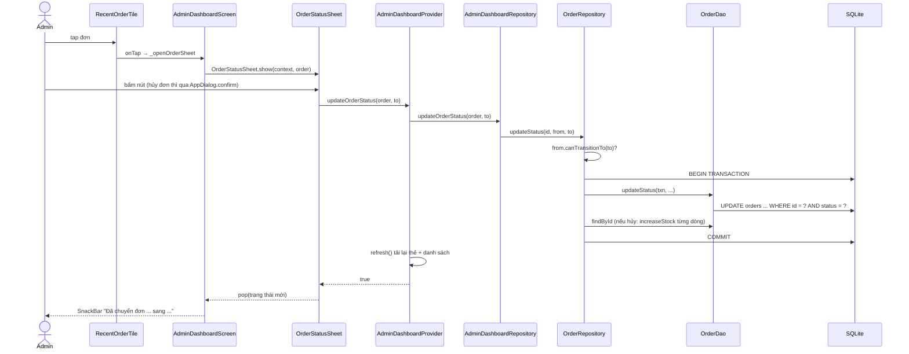

# SML-087 — UC19 Cập nhật trạng thái đơn hàng (Admin · S13)

> Người viết: Trọng · Ngày: 02/11/2026 · Nhánh: `feature/SML-087-uc19-order-status` · Phụ thuộc: SML-085 (xem [SML-085-UC16-admin-dashboard.md](admin-guide/SML-085-UC16-admin-dashboard.md))
> Số dòng trong link lấy tại thời điểm viết; nếu lệch, tìm theo **tên hàm** ghi cạnh link.

**Tóm tắt:** trong mục "Đơn gần đây" của Admin Dashboard, admin tap một đơn để mở bottom sheet và đổi trạng thái đơn theo luồng một chiều. Mỗi lần đổi ghi thời điểm vào cột tương ứng, hủy đơn thì hoàn tồn kho, và màn My Orders / Order Detail của khách thấy kết quả ngay.

## 1. Bản đồ dự án

Chủ sở hữu lấy theo bảng phân công nhóm (`example/SMASHLY - Phân công nhóm PRM393.md`).

| Thư mục trong `lib/` | Chứa gì | Owner | File cần biết |
| --- | --- | --- | --- |
| `core/constants/` | Enum dùng chung | Nhiều người | `enums.dart`: `OrderStatus`, `ViewStatus` |
| `core/database/` | Schema, mở DB, seed | Hào (`seed_orders`: Danh, `seed_catalog`: Trọng) | `db_schema.dart`, `database_helper.dart` |
| `core/services/` | Session (SharedPreferences) | Hào | `session_service.dart` |
| `core/theme/` | Màu, chữ, khoảng cách, motion | Lượng | `app_colors.dart`, `app_text_styles.dart`, `app_spacing.dart` |
| `core/utils/` | Hàm tiện ích | Nhiều người | `db_time.dart`, `app_exception.dart`, `currency_formatter.dart` |
| `data/models/` | Class dữ liệu, `fromMap` | Nhiều người | `order.dart`, `admin_dashboard.dart` |
| `data/daos/` | Câu SQL | Theo bảng | `order_dao.dart` (Danh), `admin_dashboard_dao.dart` (Trọng) |
| `data/repositories/` | Luật nghiệp vụ, transaction | Theo domain | `order_repository.dart`, `admin_dashboard_repository.dart` |
| `providers/` | State của màn hình | Theo màn | `admin_dashboard_provider.dart` |
| `routes/` | Bảng route, tạo Provider theo màn | Lượng | `app_routes.dart` |
| `shared/widgets/` | Widget dùng chung | Lượng | `order_status_badge.dart`, `app_dialog.dart`, `buttons/primary_button.dart` |
| `features/admin/` | S13, S14, S15 | Trọng | `admin_dashboard_screen.dart`, `widgets/order_status_sheet.dart` |
| `features/orders/` | S10 My Orders, S11 Order Detail | Lượng | `order_detail_screen.dart`, `widgets/order_timeline.dart` |
| `features/auth`, `profile` | Đăng nhập, hồ sơ, `AdminGuard` | Hào | `auth/admin_guard.dart` |
| `features/cart`, `checkout` | Giỏ, thanh toán | Danh | `checkout_screen.dart` |
| `features/home`, `shop`, `product`, `shell` | Mua sắm, khung tab | Kha, Lượng | `shell/app_shell.dart` |

**Khởi động app:** [`main.dart`](../lib/main.dart) khai báo Provider toàn cục (Auth, Cart, Wishlist) rồi chạy `SmashlyApp`. Provider riêng của từng màn được tạo trong `AppRoutes.screen`. `AdminDashboardProvider` thuộc nhóm này, nên chỉ sống trong route `/admin`.

## 2. Kiến trúc 4 lớp qua ví dụ thật

Luồng: Screen → Provider → Repository → DAO → SQLite. Mỗi lớp chỉ gọi lớp ngay dưới nó.

| Lớp | Việc của lớp | Ví dụ trong UC19 |
| --- | --- | --- |
| **Screen / Widget** | Vẽ UI, điều hướng | [`_changeStatus`](../lib/features/admin/widgets/order_status_sheet.dart#L43) hỏi dialog, gọi Provider, thành công thì đóng sheet. Không có SQL |
| **Provider** | Giữ state, báo UI vẽ lại | [`updateOrderStatus`](../lib/providers/admin_dashboard_provider.dart#L88) bật cờ đang lưu, bắt lỗi thành câu tiếng Việt, tải lại số liệu |
| **Repository** | Luật nghiệp vụ, transaction | [`updateStatus`](../lib/data/repositories/order_repository.dart#L202) kiểm tra luật, mở `db.transaction`, ném `AppException` |
| **DAO** | Chỉ chạy SQL | [`updateStatus`](../lib/data/daos/order_dao.dart#L167) chạy một câu UPDATE, trả về đúng hoặc sai |

Hai hàm cùng tên `updateStatus` ở Repository và DAO khác nhau rõ: DAO **không biết luật** (chỉ biết SQL), Repository **không viết SQL** (chỉ biết luật).

DAO nhận `DatabaseExecutor` thay vì `Database`. `Database` và `Transaction` đều là `DatabaseExecutor`, nên cùng một hàm chạy được cả trong lẫn ngoài transaction.

## 3. Luồng UC19 từ lúc tap đến SQLite



| # | Hàm | Việc |
| --- | --- | --- |
| 1 | [`RecentOrderTile`](../lib/features/admin/widgets/recent_order_tile.dart#L13) | Hàng đơn, bọc `InkWell`, gọi `onTap` |
| 2 | [`_openOrderSheet`](../lib/features/admin/admin_dashboard_screen.dart#L150) | Mở sheet, chờ kết quả, hiện SnackBar khi có trạng thái mới |
| 3 | [`OrderStatusSheet.show`](../lib/features/admin/widgets/order_status_sheet.dart#L24) | Xóa lỗi cũ, mở modal, truyền Provider bằng `.value` |
| 4 | [`_changeStatus`](../lib/features/admin/widgets/order_status_sheet.dart#L43) | Hủy đơn thì hỏi lại, gọi Provider, `pop(to)` khi thành công |
| 5 | [`updateOrderStatus`](../lib/providers/admin_dashboard_provider.dart#L88) (Provider) | Chặn bấm 2 lần, gọi Repository, `refresh()`, ghi `statusError` khi lỗi |
| 6 | [`updateOrderStatus`](../lib/data/repositories/admin_dashboard_repository.dart#L27) (Dashboard repo) | Chuyển tiếp sang `OrderRepository` |
| 7 | [`updateStatus`](../lib/data/repositories/order_repository.dart#L202) (Order repo) | Kiểm tra luật, mở transaction, xử lý 0 dòng, hoàn kho |
| 8 | [`updateStatus`](../lib/data/daos/order_dao.dart#L167) (DAO) | Chọn cột thời gian, chạy UPDATE, trả `changed == 1` |
| 9 | [`_restoreStock`](../lib/data/repositories/order_repository.dart#L243) | Chỉ khi hủy: gọi [`increaseStock`](../lib/data/daos/order_dao.dart#L189) cho từng dòng đơn. `cancelOrder` của khách dùng chung hàm này |

**Vì sao phía khách thấy đúng mà không phải sửa code?** Order Detail đọc lại đơn từ DB qua `getOrderDetail`, và `TimelineStep.fromOrder` chỉ dựa vào 4 cột thời gian. Ta ghi đúng cột, đúng định dạng `dbTime()` thì timeline tự đúng.

## 4. File đã tạo / sửa

| File | Thay đổi |
| --- | --- |
| [`lib/core/constants/enums.dart`](../lib/core/constants/enums.dart#L38) | Thêm luật: `allowedNextStatuses`, `canTransitionTo`, `isFinal` |
| [`lib/data/daos/order_dao.dart`](../lib/data/daos/order_dao.dart#L167) | Thêm `updateStatus`. Không đổi hàm cũ |
| [`lib/data/repositories/order_repository.dart`](../lib/data/repositories/order_repository.dart#L202) | Thêm `updateStatus`; tách vòng hoàn kho của `cancelOrder` thành `_restoreStock` (hành vi không đổi) |
| [`lib/data/repositories/admin_dashboard_repository.dart`](../lib/data/repositories/admin_dashboard_repository.dart#L27) | Thêm `updateOrderStatus` chuyển tiếp |
| [`lib/providers/admin_dashboard_provider.dart`](../lib/providers/admin_dashboard_provider.dart#L88) | Thêm `updatingStatus`, `isUpdatingStatus`, `statusError`, `updateOrderStatus`, `clearStatusError` |
| [`lib/features/admin/widgets/order_status_sheet.dart`](../lib/features/admin/widgets/order_status_sheet.dart#L19) | **Mới.** Bottom sheet đổi trạng thái |
| [`lib/features/admin/widgets/recent_order_tile.dart`](../lib/features/admin/widgets/recent_order_tile.dart#L13) | Thêm `onTap`, bọc `Material` + `InkWell` giống `LowStockTile` |
| [`lib/features/admin/admin_dashboard_screen.dart`](../lib/features/admin/admin_dashboard_screen.dart#L150) | Thêm `_openOrderSheet`, nối vào hàng đơn |
| `test/core/constants/order_status_test.dart` | **Mới.** Duyệt đủ 25 cặp chuyển trạng thái |
| `test/data/repositories/order_status_update_test.dart` | **Mới.** Ghi đúng cột, hoàn kho, rollback, dữ liệu cũ, timeline phía khách |
| `test/providers/admin_dashboard_provider_test.dart` | Thêm 4 ca: tải lại số liệu, dữ liệu cũ, bấm 2 lần, lỗi lạ |
| `test/features/admin/admin_dashboard_screen_test.dart` | Thêm 7 ca: nút theo trạng thái, thành công, hủy đơn, lỗi trong sheet |
| `docs/UC19-order-status.md` | Tài liệu này |
| `docs/admin-guide/README.md`, `SML-085-UC16-admin-dashboard.md`, `01-product-write.md` | Thêm mục lục, cập nhật số dòng bị lệch |

**Không sửa:** `db_schema.dart`, `pubspec.yaml`, `core/theme/`, `app_routes.dart`, `main.dart`, model `Order`, `features/orders/`.

## 5. Luật chuyển trạng thái

| Từ \ Sang | CONFIRMED | SHIPPING | DELIVERED | CANCELLED | Cột thời gian ghi |
| --- | --- | --- | --- | --- | --- |
| **PENDING** | ✅ | ❌ | ❌ | ✅ + hoàn kho | `confirmed_at` hoặc `cancelled_at` |
| **CONFIRMED** | ❌ | ✅ | ❌ | ✅ + hoàn kho | `shipped_at` hoặc `cancelled_at` |
| **SHIPPING** | ❌ | ❌ | ✅ | ❌ | `delivered_at` |
| **DELIVERED** | ❌ | ❌ | ❌ | ❌ | Trạng thái cuối |
| **CANCELLED** | ❌ | ❌ | ❌ | ❌ | Trạng thái cuối |

Luật chỉ nằm ở một chỗ: [`allowedNextStatuses`](../lib/core/constants/enums.dart#L38). UI dùng nó để quyết định hiện nút nào, Repository dùng nó để chặn. Đổi luật chỉ cần sửa một nơi, không thể có chuyện UI cho bấm mà Repository chặn.

**Vì sao hủy đơn phải dùng transaction?** Hủy đơn ghi 2 bảng: `orders` và `products`. Không có transaction, nếu đã đổi đơn sang CANCELLED mà cộng kho lỗi giữa chừng thì hàng bị mất vĩnh viễn khỏi kho. Trong transaction, lỗi ở bất kỳ bước nào làm mọi thay đổi rollback. Test `hoàn kho lỗi giữa transaction` chứng minh điều này bằng một trigger SQLite ném lỗi thật.

**Vì sao `WHERE status = trạng thái cũ`?** Sheet hiển thị dữ liệu đọc từ trước, DB có thể đã đổi rồi. Nếu chỉ `WHERE id = ?`, đơn đã DELIVERED vẫn có thể bị ghi đè thành CANCELLED và hoàn kho sai. Thêm điều kiện status thì câu UPDATE ảnh hưởng 0 dòng, Repository báo "Đơn đã được cập nhật ở nơi khác, vui lòng tải lại". Việc kiểm tra và ghi nằm trong **một câu SQL** nên không có khe hở giữa hai bước.

## 6. Câu hỏi vấn đáp

1. **Luật chuyển trạng thái đặt ở đâu, vì sao?** Ở enum `OrderStatus` (`allowedNextStatuses`). Đó là một nguồn sự thật duy nhất cho cả UI và Repository.
2. **UI đã ẩn nút sai rồi, sao Repository còn kiểm tra?** UI chỉ là lớp hiển thị và có thể dùng dữ liệu cũ. Luật nghiệp vụ phải được bảo vệ ở Repository, nơi mọi lời gọi đều đi qua.
3. **Transaction là gì, ở đây dùng để làm gì?** Nhóm câu lệnh hoặc thành công hết hoặc không có gì xảy ra. Ở đây nó đảm bảo đổi trạng thái và hoàn kho luôn đi cùng nhau.
4. **Trong transaction vì sao truyền `txn` cho DAO mà không dùng `db`?** Câu lệnh chạy bằng `db` nằm ngoài transaction, không được rollback, và còn có thể bị khóa chờ chính transaction đó.
5. **Cột thời gian lưu định dạng gì, vì sao?** Chuỗi UTC `YYYY-MM-DD HH:MM:SS` ghi bằng `dbTime()`, giống `CURRENT_TIMESTAMP`. UI đổi sang giờ địa phương khi hiển thị, nên sắp xếp và so sánh trong DB luôn nhất quán.
6. **Vì sao không tạo bảng lịch sử trạng thái?** Luồng cố định, mỗi trạng thái xảy ra tối đa một lần nên 4 cột là đủ. Blueprint cũng chọn cách này vì đơn giản hơn.
7. **Sao không cho hủy khi đang giao?** Hàng đã rời kho nên không thể cộng lại tồn kho ngay được. Quy trình trả hàng nằm ngoài phạm vi đồ án.
8. **Làm sao chống bấm 2 lần?** Hai lớp: nút bị khóa và hiện spinner khi đang lưu, và Provider `return false` nếu đang có thao tác. Lớp Provider cần thiết vì 2 lần bấm có thể xảy ra trước khi màn kịp vẽ lại. Có test chứng minh kho chỉ được cộng một lần.
9. **Vì sao sheet phải dùng `ChangeNotifierProvider.value`?** Bottom sheet là route riêng nằm dưới `Navigator`, không nằm trong cây con của màn Dashboard, nên không thấy Provider đó. `.value` truyền lại đúng đối tượng đang có và không dispose nó khi sheet đóng.
10. **Sau khi đổi, sao thẻ số liệu tự đúng?** Provider gọi `refresh()`, chạy lại COUNT/SUM từ DB. Không tự cộng trừ số trên RAM nên không thể lệch với dữ liệu thật.

## 7. Checklist test thủ công

**Chuẩn bị:** bản debug, vào Profile → "Reset demo data" để có seed sạch. Sau khi reset: thẻ "Đơn chờ xác nhận" = 0, "Doanh thu đã giao" = 4.130.000₫ (theo seed).

**A. Tạo đơn PENDING** (seed không có đơn PENDING)
1. Đăng nhập `customer@smashly.com` / `Customer@123`, mua 1 sản phẩm, ghi lại mã đơn, tên sản phẩm, số lượng. Đăng xuất.
2. Đăng nhập `admin@smashly.com` / `Admin@123`. **Kỳ vọng:** "Đơn chờ xác nhận" = 1, đơn mới nằm đầu "Đơn gần đây".

**B. Đi hết luồng** 📸 chụp từng bước
3. Tap đơn mới. **Kỳ vọng:** sheet có mã đơn, người nhận, tổng tiền, badge "Chờ xác nhận"; chỉ có 2 nút "Xác nhận đơn" và "Hủy đơn".
4. Bấm "Xác nhận đơn". **Kỳ vọng:** sheet đóng, SnackBar "Đã chuyển đơn SML-... sang Đã xác nhận", badge đổi, thẻ chờ xác nhận về 0.
5. Tap lại, bấm "Bắt đầu giao hàng". **Kỳ vọng:** badge "Đang giao"; sheet trước khi bấm có nút hủy, sau khi bấm thì không.
6. Tap lại. **Kỳ vọng:** chỉ có nút "Xác nhận đã giao", **không có** "Hủy đơn". Bấm nút. **Kỳ vọng:** badge "Đã giao", doanh thu tăng đúng bằng tổng tiền đơn.
7. Tap lại. **Kỳ vọng:** không có nút, chỉ có dòng "Đơn đã hoàn tất, không thể đổi trạng thái".

**C. Phía khách**
8. Đăng nhập customer, mở đơn đó trong My Orders. **Kỳ vọng:** tab và badge "Đã giao"; timeline có đủ 4 bước kèm giờ, giờ theo máy, đúng thứ tự các lần bấm. 📸

**D. Hủy đơn và hoàn kho**
9. Customer đặt đơn mới, ghi tồn kho sản phẩm (xem ở Admin Products sau khi đặt). Đăng nhập admin.
10. Tap đơn, bấm "Hủy đơn". **Kỳ vọng:** dialog "Hủy đơn SML-...? Tồn kho của các sản phẩm trong đơn sẽ được hoàn lại." 📸
11. Bấm "Giữ đơn". **Kỳ vọng:** dialog đóng, sheet còn đó, đơn không đổi.
12. Bấm lại "Hủy đơn" → "Hủy đơn". **Kỳ vọng:** SnackBar "... sang Đã hủy"; Admin Products cho thấy tồn kho tăng đúng số lượng trong đơn.
13. Lặp lại từ bước 9 nhưng "Xác nhận đơn" trước rồi mới hủy (hủy từ CONFIRMED). **Kỳ vọng:** như bước 12.
14. Tap đơn đã hủy. **Kỳ vọng:** dòng "Đơn đã hủy, không thể đổi trạng thái".
15. Đăng nhập customer, mở đơn vừa hủy từ CONFIRMED. **Kỳ vọng:** timeline: Chờ xác nhận → Đã xác nhận → Đã hủy (đỏ), có giờ. 📸

**Các ca khó tạo bằng tay** đã có test tự động: đang lưu không bấm được / không đóng được sheet (SQLite quá nhanh để nhìn thấy spinner), dữ liệu cũ, lỗi giữa transaction.

**Test tự động:**
```
flutter analyze
flutter test test/core/constants/order_status_test.dart test/data/repositories/order_status_update_test.dart test/providers/admin_dashboard_provider_test.dart test/features/admin/admin_dashboard_screen_test.dart
```

## 8. Gợi ý chia commit

Trọng tự chạy Git. Chạy `git status` để chắc không add nhầm `example/`.

| # | `git add` | Commit message |
| --- | --- | --- |
| 1 | `lib/core/constants/enums.dart` `test/core/constants/order_status_test.dart` | `feat(UC19-order-status): add order status transition rules` |
| 2 | `lib/data/daos/order_dao.dart` `lib/data/repositories/order_repository.dart` `lib/data/repositories/admin_dashboard_repository.dart` `test/data/repositories/order_status_update_test.dart` | `feat(UC19-order-status): update order status and restore stock in a transaction` |
| 3 | `lib/providers/admin_dashboard_provider.dart` `test/providers/admin_dashboard_provider_test.dart` | `feat(UC19-order-status): track order status update in dashboard provider` |
| 4 | `lib/features/admin/widgets/order_status_sheet.dart` `lib/features/admin/widgets/recent_order_tile.dart` `lib/features/admin/admin_dashboard_screen.dart` `test/features/admin/admin_dashboard_screen_test.dart` | `feat(UC19-order-status): allow admin to update order status` |
| 5 | `docs/UC19-order-status.md` `docs/admin-guide/README.md` `docs/admin-guide/SML-085-UC16-admin-dashboard.md` `docs/admin-guide/01-product-write.md` | `docs(UC19-order-status): add order status guide and fix line links` |

## 9. Lưu ý và hạn chế

- **Chỉ đổi được 5 đơn mới nhất:** Dashboard chỉ hiện 5 đơn và chưa có màn quản lý toàn bộ đơn. Đơn cũ hơn không tap được.
- **Hủy đơn seed làm tồn kho cao hơn seed:** đơn seed không trừ kho lúc tạo (ghi chú trong `seed_orders.dart`), nên hủy đơn seed #3 sẽ cộng thêm 1 vào tồn kho "Game Shirt". Khi demo hoàn kho, nên dùng đơn đặt thật.
- **Repository gọi Repository:** `AdminDashboardRepository.updateOrderStatus` chuyển tiếp sang `OrderRepository`, vì không sửa `app_routes.dart` để truyền thêm tham số cho Provider. Nếu được sửa, chỉ cần vài dòng ở route là Provider nhận thẳng `OrderRepository`, gọn và đúng lớp hơn.
- **Khách và admin có quyền hủy khác nhau, có chủ ý:** khách chỉ hủy khi PENDING (`cancelPendingOrder`), admin hủy được cả khi CONFIRMED. Blueprint cũng ghi như vậy.
- **Lỗi dữ liệu cũ không tự tải lại:** sheet báo lỗi và admin tự kéo để làm mới, đúng với câu thông báo.
