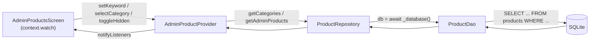
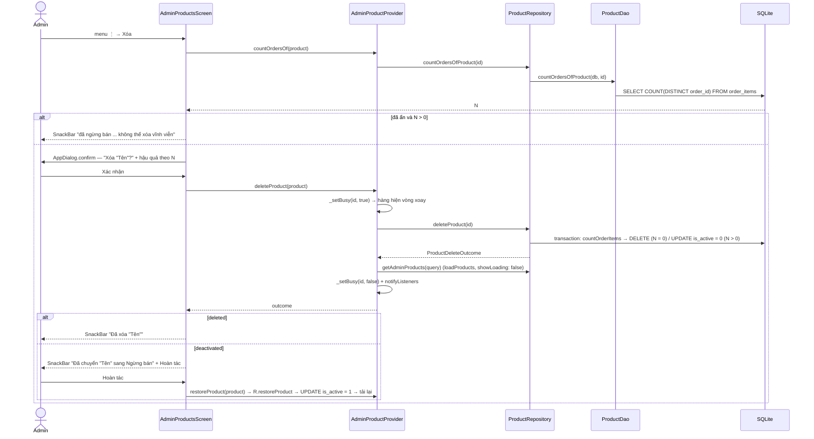

# SML-084 — UC17 Quản lý danh sách sản phẩm (Admin Products · S14)

> Người viết: Trọng · Ngày: 15/10/2026 · Nhánh: `feature/SML-084-uc17-admin-products`
> Phụ thuộc: SML-083 (ghi sản phẩm — xem [01-product-write.md](01-product-write.md)).
> Số dòng trong link lấy tại thời điểm viết; nếu lệch, tìm theo **tên hàm** ghi cạnh link.

## 1. Tổng quan

**UC17 — Quản lý danh sách sản phẩm**, actor **Admin**. Màn S14 cho admin:

- Xem **toàn bộ** sản phẩm, kể cả sản phẩm đang ẩn / ngừng bán (`is_active = 0`) — khác màn Shop của khách chỉ thấy sản phẩm đang bán.
- **Tìm** theo tên hoặc thương hiệu (không phân biệt hoa thường, debounce 300 ms).
- **Lọc** theo danh mục (chip) và chip **"Đang ẩn"**; các bộ lọc kết hợp với nhau bằng AND.
- **Xóa** sản phẩm qua dialog xác nhận nêu **tên sản phẩm** và **hậu quả**: chưa có trong đơn → xóa vĩnh viễn; đã có trong đơn → chuyển sang Ngừng bán, SnackBar có nút **Hoàn tác**.
- Tồn kho hiển thị **màu + chữ + icon**: `Kho: 12` (xanh), `3 · Sắp hết` (cam), `0 · Hết` (đỏ).
- Đủ 4 trạng thái: loading, empty (2 kiểu: chưa có sản phẩm / lọc không ra), error (nút Thử lại), success.

**Ngoài phạm vi:** form thêm/sửa (S15, route `adminProductForm` vẫn là placeholder — tap hàng và FAB đã điều hướng sẵn tới đó), menu Ẩn/Hiện (blueprint có, backlog chưa yêu cầu), Dashboard S13.

**Tiêu chí chấp nhận**

| Tiêu chí | Đáp ứng ở đâu |
| --- | --- |
| Dialog xóa nêu tên sản phẩm + hậu quả | [`_confirmDelete`](../../lib/features/admin/admin_products_screen.dart#L293): tiêu đề `Xóa "Tên"?`, nội dung khác nhau theo số đơn hàng |
| Tồn kho bằng màu + chữ | [`AdminStockLabel`](../../lib/features/admin/widgets/admin_stock_label.dart#L12), có test [admin_stock_label_test.dart](../../test/features/admin/admin_stock_label_test.dart) |

## 2. Những gì đã làm

### File tạo mới

| File | Mô tả |
| --- | --- |
| [lib/data/models/admin_product_query.dart](../../lib/data/models/admin_product_query.dart#L5) | `AdminProductQuery`: điều kiện lọc (`keyword`, `categoryId`, `onlyHidden`) + `hasFilter` + `copyWith`. Tách riêng để không sửa `ProductQuery` của Kha |
| [lib/providers/admin_product_provider.dart](../../lib/providers/admin_product_provider.dart#L13) | `AdminProductProvider`: giữ query, danh sách, danh mục, `ViewStatus`; tìm/lọc/xóa/hoàn tác |
| [lib/features/admin/admin_products_screen.dart](../../lib/features/admin/admin_products_screen.dart#L20) | Màn S14: header Midnight + ô search, hàng chip lọc, danh sách theo 4 trạng thái, FAB, luồng xóa |
| [lib/features/admin/widgets/admin_product_tile.dart](../../lib/features/admin/widgets/admin_product_tile.dart#L14) | Một hàng sản phẩm: ảnh 56, tên, brand · danh mục, giá, tồn kho, nhãn "Đang ẩn", menu ⋮ Sửa / Xóa |
| [lib/features/admin/widgets/admin_stock_label.dart](../../lib/features/admin/widgets/admin_stock_label.dart#L12) | `AdminStockLabel` (tồn kho màu + chữ) và `AdminHiddenLabel` ("Đang ẩn") |
| [test/providers/admin_product_provider_test.dart](../../test/providers/admin_product_provider_test.dart) | 7 ca test Provider trên SQLite in-memory có seed |
| [test/features/admin/admin_stock_label_test.dart](../../test/features/admin/admin_stock_label_test.dart) | Kiểm tra 3 mức tồn kho có đúng chữ + màu |

### File sửa

| File | Mô tả |
| --- | --- |
| [lib/data/daos/product_dao.dart](../../lib/data/daos/product_dao.dart#L260) | Thêm khối `// ===== ADMIN READ (Trọng) =====` cuối file với `getAdminProducts` + import model mới |
| [lib/data/repositories/product_repository.dart](../../lib/data/repositories/product_repository.dart#L191) | Thêm `getAdminProducts(query)` bọc lỗi thành `AppException` + import |
| [lib/routes/app_routes.dart](../../lib/routes/app_routes.dart#L202) | Thay đúng dòng placeholder `adminProducts` bằng `ChangeNotifierProvider<AdminProductProvider>` + `AdminProductsScreen` (file của Lượng, theo quy tắc ghi trong file) |
| [test/routes/app_routes_test.dart](../../test/routes/app_routes_test.dart#L72) | Bỏ `AppRoutes.adminProducts` khỏi map `pushedRoutes` vì route này không còn là `PlaceholderScreen` (file của Lượng — cần báo Lượng) |

## 3. Nguyên lí hoạt động

### 3.1. Luồng dữ liệu

- **Route** tạo Provider (`ChangeNotifierProvider` ngay tại route, tự hủy khi rời màn) và gọi `loadInitial()`.
- **Screen** chỉ đọc state và `switch` trên `status`; không biết gì về SQL.
- **Provider** giữ `AdminProductQuery` hiện tại; mọi thao tác lọc chỉ **đổi query rồi gọi `loadProducts()`**.
- **Repository** mở DB, gọi DAO, đổi mọi lỗi thành `AppException` tiếng Việt.
- **DAO** dựng câu `SELECT` duy nhất từ query.

### 3.2. Search và lọc kết hợp với nhau thế nào

Ba điều kiện độc lập, cái nào bật thì thêm vào danh sách `WHERE` và nối bằng `AND`:

| Bộ lọc | Điều kiện SQL | Tham số |
| --- | --- | --- |
| Từ khóa (khác rỗng sau `trim`) | `(name LIKE ? COLLATE NOCASE OR brand LIKE ? COLLATE NOCASE)` | `%từ khóa%` × 2 |
| Danh mục | `category_id = ?` | id danh mục |
| Chip "Đang ẩn" | `is_active = 0` | — |

Không bật gì → không có `WHERE` → lấy hết (cả sản phẩm đang ẩn). Sắp xếp `id DESC` (mới thêm lên đầu). Ví dụ: gõ "yonex" + chip "Vợt" + "Đang ẩn" → các cây vợt Yonex đang ẩn.

Chống kết quả cũ ghi đè (giống `ShopProvider`): mỗi lần `loadProducts()` tăng `_requestId`; khi kết quả về mà `_requestId` đã đổi (người dùng gõ tiếp / bấm chip khác) thì bỏ qua.

**Empty có 2 kiểu**, phân biệt bằng `query.hasFilter`:
- Có bộ lọc → "Không có sản phẩm phù hợp" + nút **Xóa bộ lọc** (`resetFilters`).
- Không lọc gì mà vẫn rỗng → "Chưa có sản phẩm nào" + nút **Thêm sản phẩm**.

### 3.3. Luồng xóa

Nội dung dialog:

- **N = 0** — nút "Xóa vĩnh viễn": *Sản phẩm sẽ bị xóa vĩnh viễn, đồng thời bị gỡ khỏi giỏ hàng và danh sách yêu thích của khách. Không thể hoàn tác.*
- **N > 0** — nút "Ngừng bán": *Sản phẩm đã có trong N đơn hàng nên sẽ được chuyển sang Ngừng bán thay vì xóa vĩnh viễn. Khách không còn thấy sản phẩm, đơn hàng cũ vẫn giữ nguyên.*

Tải lại sau xóa dùng `showLoading: false` để danh sách không nháy sang spinner; lỗi ở bất kỳ bước nào → `AppException` → SnackBar.

## 4. Chi tiết các hàm

### 4.1. DAO — [ProductDao](../../lib/data/daos/product_dao.dart)

#### `getAdminProducts(DatabaseExecutor db, AdminProductQuery query)` — [product_dao.dart#L264](../../lib/data/daos/product_dao.dart#L264)
- **Trả về:** `Future<List<Product>>`.
- **Làm gì:** dựng `WHERE` từ 3 bộ lọc (mục 3.2), `db.query(products, orderBy: 'id DESC')`, map sang `Product.fromMap`. **Không** lọc `is_active = 1` như `search()` của Shop.
- **Ai gọi:** `ProductRepository.getAdminProducts`.

Các hàm DAO dùng lại từ SML-083 / Kha (không sửa): `getCategories` ([#L14](../../lib/data/daos/product_dao.dart#L14)), `countOrdersOfProduct` ([#L177](../../lib/data/daos/product_dao.dart#L177)), `countOrderItems` ([#L168](../../lib/data/daos/product_dao.dart#L168)), `deleteProduct` ([#L187](../../lib/data/daos/product_dao.dart#L187)), `setActive` ([#L195](../../lib/data/daos/product_dao.dart#L195)).

### 4.2. Repository — [ProductRepository](../../lib/data/repositories/product_repository.dart)

#### `getAdminProducts(AdminProductQuery query)` — [product_repository.dart#L191](../../lib/data/repositories/product_repository.dart#L191)
- **Trả về:** `Future<List<Product>>`; lỗi bất kỳ → `AppException('Không thể tải danh sách sản phẩm. Vui lòng thử lại.')`.
- **Ai gọi:** `AdminProductProvider.loadProducts`. **Gọi tiếp:** `_database()`, `ProductDao.getAdminProducts`.

Dùng lại (SML-083): `getCategories` ([#L24](../../lib/data/repositories/product_repository.dart#L24)), `countOrdersOfProduct` ([#L140](../../lib/data/repositories/product_repository.dart#L140)), `deleteProduct` ([#L152](../../lib/data/repositories/product_repository.dart#L152)) — quyết định xóa thật / ngừng bán trong transaction, `restoreProduct` ([#L177](../../lib/data/repositories/product_repository.dart#L177)).

### 4.3. Provider — [AdminProductProvider](../../lib/providers/admin_product_provider.dart#L13)

| Hàm | Tham số → trả về | Làm gì | Gọi khi nào | Gọi tiếp |
| --- | --- | --- | --- | --- |
| [`loadInitial`](../../lib/providers/admin_product_provider.dart#L55) | → `Future<void>` | `status = loading`, tải danh mục; lỗi → `error`; được thì tải sản phẩm | Route tạo Provider | `repository.getCategories`, `loadProducts` |
| [`loadProducts`](../../lib/providers/admin_product_provider.dart#L75) | `{showLoading = true}` → `Future<void>` | Chụp query hiện tại, truy vấn, gán `success` / `empty` / `error`; bỏ qua kết quả cũ (`_requestId`) hoặc khi đã dispose | Mọi thao tác lọc, Enter ở ô search, sau xóa/hoàn tác | `repository.getAdminProducts` |
| [`retry`](../../lib/providers/admin_product_provider.dart#L105) | → `Future<void>` | Chưa có danh mục → `loadInitial`, có rồi → `loadProducts` | Nút "Thử lại" ở ErrorState | `loadInitial` / `loadProducts` |
| [`refresh`](../../lib/providers/admin_product_provider.dart#L110) | → `Future<void>` | Tải lại không hiện spinner | Kéo xuống (RefreshIndicator), quay về từ S15 | `loadProducts(showLoading: false)` |
| [`setKeyword`](../../lib/providers/admin_product_provider.dart#L118) | `String` → `void` | Cập nhật keyword, hủy timer cũ, vô hiệu request đang chạy, hẹn 300 ms rồi tải | Mỗi lần gõ / bấm X | `Timer` → `loadProducts` |
| [`selectCategory`](../../lib/providers/admin_product_provider.dart#L125) | `int?` → `Future<void>` | Đổi danh mục (`null` = Tất cả) | Bấm chip danh mục | `loadProducts` |
| [`toggleHidden`](../../lib/providers/admin_product_provider.dart#L135) | → `Future<void>` | Bật/tắt `onlyHidden` | Bấm chip "Đang ẩn" | `loadProducts` |
| [`resetFilters`](../../lib/providers/admin_product_provider.dart#L141) | → `Future<void>` | Về query rỗng | Nút "Xóa bộ lọc" ở empty | `loadProducts` |
| [`countOrdersOf`](../../lib/providers/admin_product_provider.dart#L151) | `Product` → `Future<int>` | Số đơn chứa sản phẩm; ném `AppException` | Trước khi mở dialog xóa | `repository.countOrdersOfProduct` |
| [`deleteProduct`](../../lib/providers/admin_product_provider.dart#L157) | `Product` → `Future<ProductDeleteOutcome>` | Đánh dấu busy, xóa, tải lại danh sách, bỏ busy; ném `AppException` | Admin xác nhận dialog | `repository.deleteProduct`, `loadProducts` |
| [`restoreProduct`](../../lib/providers/admin_product_provider.dart#L170) | `Product` → `Future<void>` | Bán lại sản phẩm, tải lại danh sách | Nút "Hoàn tác" trên SnackBar | `repository.restoreProduct`, `loadProducts` |
| [`categoryNameOf`](../../lib/providers/admin_product_provider.dart#L46) | `int` → `String` | Tên danh mục (tiếng Anh như DB) theo id | Khi dựng mỗi hàng | — |
| [`isBusy`](../../lib/providers/admin_product_provider.dart#L43) | `int` → `bool` | Hàng đang xóa/khôi phục? | Khi dựng mỗi hàng | — |
| [`dispose`](../../lib/providers/admin_product_provider.dart#L187) | — | Hủy timer, vô hiệu request đang chạy | Rời màn | — |

### 4.4. Màn hình — [AdminProductsScreen](../../lib/features/admin/admin_products_screen.dart#L20)

| Hàm | Làm gì | Gọi tiếp |
| --- | --- | --- |
| [`build`](../../lib/features/admin/admin_products_screen.dart#L39) | `context.watch<AdminProductProvider>()`, ghép header + bộ lọc + body + FAB | `_buildHeader`, `_buildFilters`, `_buildBody` |
| [`_buildHeader`](../../lib/features/admin/admin_products_screen.dart#L61) | Dải gradient Midnight, nút Back (nếu có màn trước), tiêu đề + số sản phẩm, ô search có nút X | `setKeyword`, `loadProducts` (Enter), `_clearSearch` |
| [`_buildFilters`](../../lib/features/admin/admin_products_screen.dart#L154) | Chip "Đang ẩn" (FilterChip) + "Tất cả" + chip từng danh mục (tên tiếng Việt) | `toggleHidden`, `selectCategory` qua `_runFilter` |
| [`_buildBody`](../../lib/features/admin/admin_products_screen.dart#L212) | `switch (status)`: LoadingState / ErrorState (Thử lại) / 2 kiểu EmptyState / danh sách | `retry`, `_resetFilters`, `_openForm`, `_buildList` |
| [`_buildList`](../../lib/features/admin/admin_products_screen.dart#L246) | `RefreshIndicator` + `ListView` các `AdminProductTile` | `refresh`, `_openForm`, `_confirmDelete` |
| [`_openForm`](../../lib/features/admin/admin_products_screen.dart#L281) | `pushNamed(adminProductForm, arguments: id \| null)`, quay về thì `refresh` | — |
| [`_confirmDelete`](../../lib/features/admin/admin_products_screen.dart#L293) | Đếm đơn → dialog tên + hậu quả → xóa → SnackBar theo outcome | `countOrdersOf`, `AppDialog.confirm`, `deleteProduct`, `_showMessage` |
| [`_undoDeactivate`](../../lib/features/admin/admin_products_screen.dart#L355) | Hoàn tác ngừng bán, báo kết quả | `restoreProduct`, `_showMessage` |
| [`_showMessage`](../../lib/features/admin/admin_products_screen.dart#L368) | Xóa SnackBar cũ, hiện SnackBar mới (có thể kèm action) | — |
| [`adminCategoryLabel`](../../lib/features/admin/admin_category_label.dart#L2) | Đổi tên danh mục DB (Rackets...) sang tiếng Việt (Vợt...). Từ UC18 tách ra file riêng để S15 dùng chung | — |

Widget: [`AdminProductTile`](../../lib/features/admin/widgets/admin_product_tile.dart#L14) (nhận `product`, `categoryName`, `onEdit`, `onDelete`, `busy`; sản phẩm ẩn: nền xám, ảnh mờ, chữ muted + nhãn "Đang ẩn"), [`AdminStockLabel`](../../lib/features/admin/widgets/admin_stock_label.dart#L12) (ngưỡng "Sắp hết" dùng chung `StockBadge.lowStockThreshold = 5`), [`AdminHiddenLabel`](../../lib/features/admin/widgets/admin_stock_label.dart#L50).

## 5. Các thay đổi so với code cũ

- **DAO:** chỉ **thêm** `getAdminProducts`; không sửa hàm của Kha hay các hàm ghi của SML-083.
- **Repository:** chỉ **thêm** `getAdminProducts`.
- **Model:** thêm file `admin_product_query.dart`; `Product`, `Category`, `ProductQuery` giữ nguyên.
- **Routes:** `adminProducts` từ `PlaceholderScreen` → màn thật. Không thêm/xóa route nào.
- **Test route:** bỏ 1 dòng `adminProducts` trong `app_routes_test.dart` (route không còn là placeholder và cần DB thật).
- **Database:** không đổi schema, không đổi seed, không đổi `DbSchema.version`.
- **Package:** không thêm.

## 6. Cách test thủ công

Mở màn: chạy `flutter run --dart-define=START_ROUTE=/dev` → **S14 · Admin Products** (hoặc đăng nhập admin rồi đi từ Dashboard khi S13 xong).

**Search**
1. Gõ `astrox` → sau ~0,3 s chỉ còn các cây Astrox; tiêu đề hiện đúng số sản phẩm.
2. Gõ `VICTOR` (chữ hoa) → ra sản phẩm brand Victor (tìm theo brand, không phân biệt hoa thường).
3. Bấm X → hiện lại toàn bộ.

**Lọc**
4. Bấm chip "Vợt" → chỉ còn vợt; bấm "Tất cả" → bỏ lọc.
5. Xóa (ngừng bán) một sản phẩm có trong đơn (bước 9) rồi bấm chip "Đang ẩn" → chỉ còn sản phẩm đó, có nhãn "Đang ẩn".
6. Kết hợp: gõ `yonex` + chip "Vợt" + "Đang ẩn" → chỉ ra vợt Yonex đang ẩn.

**Tồn kho:** kiểm tra hàng có stock > 5 hiện "Kho: N" xanh, 1–5 hiện "N · Sắp hết" cam, 0 hiện "0 · Hết" đỏ, mỗi nhãn đều có icon + chữ.

**Xóa**
7. Thêm một sản phẩm chưa bán (khi S15 xong) hoặc chọn sản phẩm không có trong `seed_orders` → ⋮ → Xóa → dialog `Xóa "Tên"?` nói "xóa vĩnh viễn… gỡ khỏi giỏ hàng…" → **Xóa vĩnh viễn** → hàng biến mất, SnackBar `Đã xóa "Tên"`.
8. Mở dialog rồi bấm **Hủy** / bấm ra ngoài → không có gì thay đổi.
9. Chọn sản phẩm đã có trong đơn (ví dụ sản phẩm trong đơn demo) → dialog nói "đã có trong N đơn hàng… Ngừng bán" → **Ngừng bán** → hàng chuyển xám + "Đang ẩn", SnackBar có **Hoàn tác** → bấm → hàng trở lại bình thường, SnackBar "Đã bán lại".
10. Xóa lại sản phẩm đang ẩn có đơn → SnackBar "đã ngừng bán … không thể xóa vĩnh viễn", không mở dialog.
11. Sang màn Shop của khách → sản phẩm ngừng bán không còn xuất hiện.

**Trạng thái**
12. **Loading:** mở màn → thấy spinner "Đang tải sản phẩm..." trong tích tắc.
13. **Empty (lọc):** gõ `zzzz` → "Không có sản phẩm phù hợp" + **Xóa bộ lọc** → bấm → về danh sách đầy đủ, ô search được xóa.
14. **Empty (không có dữ liệu):** khó tạo trên seed; được kiểm bằng logic `query.hasFilter == false` (đọc code `_buildBody`).
15. **Error:** khó tạo bằng tay; đã có test tự động `lỗi DB → error, Thử lại tải được`. Để thử bằng mắt, tạm cho `ProductRepository.getAdminProducts` ném `AppException` → màn hiện ErrorState + **Thử lại**.

**Test tự động:** `flutter test test/providers/admin_product_provider_test.dart test/features/admin` (8 ca).

## 7. Gợi ý chia commit

Chỉ là gợi ý — Trọng tự chạy git.

1. `feat(UC17-admin-products): add admin product query and dao read for all products`
   - `lib/data/models/admin_product_query.dart`
   - `lib/data/daos/product_dao.dart`
   - `lib/data/repositories/product_repository.dart`
2. `feat(UC17-admin-products): add admin product provider with search, filters and delete`
   - `lib/providers/admin_product_provider.dart`
   - `test/providers/admin_product_provider_test.dart`
3. `feat(UC17-admin-products): add admin products screen with stock labels and delete dialog`
   - `lib/features/admin/admin_products_screen.dart`
   - `lib/features/admin/widgets/admin_product_tile.dart`
   - `lib/features/admin/widgets/admin_stock_label.dart`
   - `test/features/admin/admin_stock_label_test.dart`
4. `feat(UC17-admin-products): wire admin products route to real screen`
   - `lib/routes/app_routes.dart`
   - `test/routes/app_routes_test.dart`
5. `docs(UC17-admin-products): add admin guide for admin products screen`
   - `docs/admin-guide/SML-084-UC17-admin-products.md`
   - `docs/admin-guide/README.md`

Không đưa vào commit: `pubspec.lock`, `windows/flutter/*`, `example/` (đã thay đổi sẵn từ trước, không thuộc nhiệm vụ này).

## 8. Hạn chế / việc còn lại

- **S15 Form chưa có:** tap hàng / FAB đang mở placeholder; khi làm S15 cần thêm "hàng vừa sửa nháy nền 1 lần" như blueprint.
- **Ẩn/Hiện trong menu ⋮** (blueprint S14) chưa làm vì ngoài tiêu chí chấp nhận; `ProductRepository.restoreProduct` + `ProductDao.setActive` đã sẵn sàng để thêm.
- **Chip chưa có số lượng** (`Vợt (8)`) như ảnh mẫu — cần thêm một truy vấn `COUNT … GROUP BY category_id`.
- **Báo Lượng:** đã sửa 1 dòng trong `app_routes.dart` (đúng quy ước "thay dòng placeholder của mình") và bỏ 1 dòng trong `test/routes/app_routes_test.dart`.
- **Tên danh mục tiếng Việt** đang lặp lại với `ShopScreen._categoryName` (private của Kha); nếu nhóm muốn, nên chuyển về một chỗ dùng chung.
- `flutter analyze` còn 4 issue có sẵn từ trước ở file của người khác (`product_repository.dart` constructor, `hero_banner.dart`, `section_header.dart`) — không thuộc phần này.
