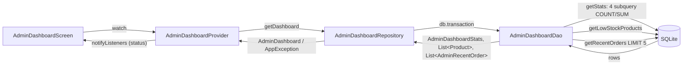
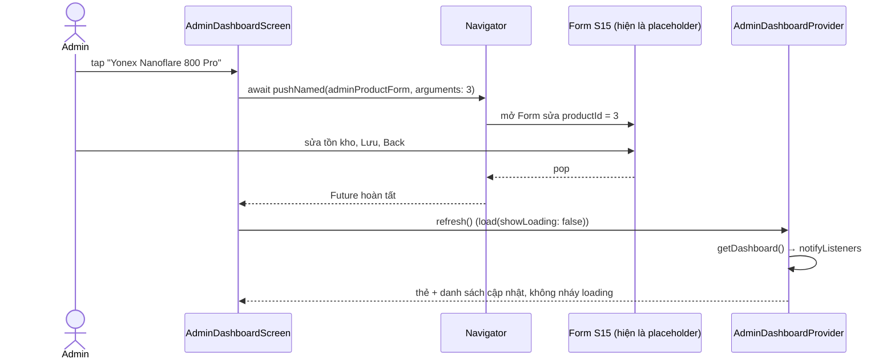

# SML-085 — UC16 Xem bảng điều khiển quản trị (Admin Dashboard · S13)

> Người viết: Trọng · Ngày: 15/10/2026 · Nhánh: `feature/SML-085-uc16-admin-dashboard`
> Phụ thuộc: SML-084 (UC17 Admin Products — xem [SML-084-UC17-admin-products.md](SML-084-UC17-admin-products.md)), SML-064 (UC13 OrderDao đọc đơn — Danh, đang In Progress).
> Số dòng trong link lấy tại thời điểm viết; nếu lệch, tìm theo **tên hàm** ghi cạnh link.

## 1. Tổng quan

**UC16 — Xem bảng điều khiển quản trị**, actor **Admin**. Đây là màn gốc của khu Admin (Login/Splash đưa admin về `AppRoutes.adminDashboard`). Màn gồm:

- **4 thẻ số liệu** (theo blueprint S13): Tổng sản phẩm · Sắp hết hàng (≤ 5) · Đơn chờ xác nhận · Doanh thu đơn đã giao (định dạng `4.130.000₫`). Số đếm từ 0 lên trong 600 ms.
- **Sắp hết hàng**: sản phẩm đang bán có tồn kho ≤ 5, ít hàng nhất lên đầu, tồn kho hiển thị bằng màu + chữ giống S14 (`AdminStockLabel`). **Tap → mở Form sửa đúng sản phẩm đó** (S15).
- **Đơn gần đây**: 5 đơn mới nhất của mọi khách (mã đơn, khách hàng, ngày giờ, tổng tiền, trạng thái).
- Nút **"Quản lý sản phẩm"** → S14.
- **Kéo xuống để làm mới**; quay lại từ Form / Products thì số liệu tự làm mới.
- Trạng thái: loading, error (nút Thử lại), success; **empty theo từng mục** (không có sản phẩm sắp hết / chưa có đơn hàng).

**Ngoài phạm vi:** Form S15 (ID backlog khác), menu avatar Hồ sơ / Đăng xuất, tap thẻ số liệu mở danh sách lọc, bottom sheet đổi trạng thái đơn (SHOULD). Xem mục 9.

**Tiêu chí chấp nhận**

| Tiêu chí | Đáp ứng ở đâu |
| --- | --- |
| Số liệu đúng với seed | Truy vấn trong [`AdminDashboardDao`](../../lib/data/daos/admin_dashboard_dao.dart#L13); đối chiếu bằng test DAO và widget test của màn hình (mục 6) |
| Tap sản phẩm sắp hết mở Form | [`_openForm`](../../lib/features/admin/admin_dashboard_screen.dart#L141): `pushNamed(adminProductForm, arguments: product.id)` rồi `refresh()`. Hiện route Form vẫn là placeholder S15 (mục 9) |

### Quyết định về thẻ "Sắp hết hàng": 3 chứ không phải 2

Mockup `example/s13_admin_dashboard` ghi thẻ **2** nhưng danh sách ngay bên dưới lại có **3** dòng (gồm Axforce 80 tồn kho 0). Nhóm chọn **đếm ≤ 5 kể cả 0 → 3**, vì:

1. Mô tả backlog và blueprint đều ghi "tồn kho ≤ 5"; hết hàng (0) là trường hợp cần nhập gấp nhất, bỏ ra là sai nghĩa.
2. Thẻ và danh sách dùng **cùng một điều kiện** `is_active = 1 AND stock <= 5` (hằng `_lowStockWhere`), nên số trên thẻ **luôn bằng** số dòng danh sách — admin không phải thắc mắc "sao thẻ ghi 2 mà thấy 3 dòng".

## 2. Những gì đã làm

### File tạo mới

| File | Mô tả |
| --- | --- |
| [lib/data/models/admin_dashboard.dart](../../lib/data/models/admin_dashboard.dart#L5) | `AdminDashboardStats` (4 số), `AdminRecentOrder` (bọc `Order` có sẵn + tên khách), `AdminDashboard` (gom cả 3 phần) |
| [lib/data/daos/admin_dashboard_dao.dart](../../lib/data/daos/admin_dashboard_dao.dart#L13) | 3 truy vấn chỉ đọc: `getStats` (COUNT/SUM), `getLowStockProducts`, `getRecentOrders` (ORDER BY … LIMIT 5) |
| [lib/data/repositories/admin_dashboard_repository.dart](../../lib/data/repositories/admin_dashboard_repository.dart#L9) | `getDashboard()`: chạy 3 truy vấn trong một transaction, đổi lỗi DB thành `AppException` |
| [lib/providers/admin_dashboard_provider.dart](../../lib/providers/admin_dashboard_provider.dart#L13) | `AdminDashboardProvider`: `ViewStatus`, `load` / `refresh` / `retry`, chống kết quả cũ ghi đè |
| [lib/features/admin/admin_dashboard_screen.dart](../../lib/features/admin/admin_dashboard_screen.dart#L22) | Màn S13: header Midnight, lưới 2×2 thẻ, 2 mục danh sách, nút Quản lý sản phẩm, điều hướng + làm mới |
| [lib/features/admin/widgets/dashboard_stat_card.dart](../../lib/features/admin/widgets/dashboard_stat_card.dart#L12) | Một thẻ số liệu: nhãn, icon nền nhạt, số đếm từ 0 lên (`TweenAnimationBuilder`, `AppMotion.emphasis` = 600 ms) |
| [lib/features/admin/widgets/low_stock_tile.dart](../../lib/features/admin/widgets/low_stock_tile.dart#L10) | Một hàng "Sắp hết hàng": ảnh 48, tên, `AdminStockLabel`, mũi tên; tap gọi `onTap` |
| [lib/features/admin/widgets/recent_order_tile.dart](../../lib/features/admin/widgets/recent_order_tile.dart#L11) | Một hàng "Đơn gần đây": mã đơn, khách, ngày giờ, tổng tiền, `OrderStatusBadge` |
| [test/data/daos/admin_dashboard_dao_test.dart](../../test/data/daos/admin_dashboard_dao_test.dart) | 5 ca test đối chiếu số liệu với seed (SQLite in-memory) |
| [test/providers/admin_dashboard_provider_test.dart](../../test/providers/admin_dashboard_provider_test.dart) | 3 ca test Provider: load, refresh sau khi đổi tồn kho, lỗi + retry |
| [test/features/admin/admin_dashboard_screen_test.dart](../../test/features/admin/admin_dashboard_screen_test.dart) | Widget test: dựng màn trên DB seed, kiểm tra chữ hiển thị (thẻ, tồn kho, đơn) và tap Nanoflare 800 Pro mở route Form với `productId = 3` |
| `docs/admin-guide/SML-085-UC16-admin-dashboard.md` | Tài liệu này |

### File sửa

| File | Thay đổi |
| --- | --- |
| [lib/routes/app_routes.dart](../../lib/routes/app_routes.dart) | Thay dòng placeholder `adminDashboard` bằng `ChangeNotifierProvider<AdminDashboardProvider>(…..load())` + 4 import cho Dashboard. **Thêm 5 import bị rơi khi merge PR #21** (`OrderDao`, `OrderRepository`, `MyOrdersScreen`, `OrderDetailScreen`, `AuthProvider`) — trước đó file không compile (file của Lượng, Trọng đồng ý sửa) |
| [test/routes/app_routes_test.dart](../../test/routes/app_routes_test.dart) | `/admin` không còn là placeholder: bỏ khỏi danh sách `pushedRoutes` (giống SML-084 đã làm với `/admin/products`); test `goToTab … không có AppShell` đổi sang route placeholder S15 |
| [docs/admin-guide/README.md](README.md) | Thêm 1 dòng mục lục |

**Không sửa:** `order_dao.dart`, `order_repository.dart` (Danh), `product_dao.dart`, `db_schema.dart`, seed, model `Order` / `Product`.

## 3. Nguyên lí hoạt động

### Luồng dữ liệu



1. Route `adminDashboard` tạo Provider và gọi `load()` ngay.
2. `load()` đặt `status = loading` → Repository mở transaction, gọi lần lượt 3 hàm DAO → trả về một `AdminDashboard`.
3. Thành công: `status = success`; lỗi DB: Repository ném `AppException` → `status = error` + `errorMessage`.
4. Màn hình `switch` trên `status` để chọn `LoadingState` / `ErrorState` / nội dung.

Vì sao gói trong **một transaction**: thẻ "Sắp hết hàng" và danh sách bên dưới được đọc từ cùng một trạng thái DB, nên không thể lệch nhau (ví dụ có người sửa tồn kho đúng lúc đang tải).

Vì sao **DAO riêng** chứ không dùng `OrderDao`: SML-064 (Danh) đang In Progress, `order_dao.dart` còn có thể đổi. Dashboard chỉ dùng chung **model** `Order` / `OrderStatus` để map dữ liệu, không gọi hàm nào của `OrderDao`.

### Cách tính từng thẻ

Một câu `SELECT` duy nhất, mỗi thẻ là một subquery ([`getStats`](../../lib/data/daos/admin_dashboard_dao.dart#L25)):

| Thẻ | SQL | Ghi chú |
| --- | --- | --- |
| Tổng sản phẩm | `SELECT COUNT(*) FROM products` | Gồm cả sản phẩm đang ẩn, khớp số lượng của S14 khi không lọc |
| Sắp hết hàng | `SELECT COUNT(*) FROM products WHERE is_active = 1 AND stock <= 5` | Cùng điều kiện với danh sách; sản phẩm ẩn không bán nên không cần nhập |
| Đơn chờ xác nhận | `SELECT COUNT(*) FROM orders WHERE status = 'PENDING'` | Giá trị status lấy từ `OrderStatus.pending.dbValue` |
| Doanh thu đã giao | `SELECT COALESCE(SUM(total), 0) FROM orders WHERE status = 'DELIVERED'` | `total` = tiền hàng + phí ship; `COALESCE` để chưa có đơn thì ra 0 thay vì NULL |

### Danh sách sắp hết hàng

```sql
SELECT * FROM products
WHERE is_active = 1 AND stock <= 5
ORDER BY stock ASC, name ASC
```

### 5 đơn gần đây

```sql
SELECT o.*, u.full_name AS customer_name
FROM orders AS o
LEFT JOIN users AS u ON u.id = o.user_id
ORDER BY o.created_at DESC, o.id DESC
LIMIT 5
```

Sắp xếp mới nhất trước giống quy ước của SML-064 (`id DESC` để phân định khi trùng giờ). Mỗi dòng map bằng `Order.fromMap` có sẵn; tên khách là `users.full_name` (nếu thiếu user thì lấy `receiver_name`).

### Luồng tap sản phẩm → Form → quay lại → làm mới



Nút "Quản lý sản phẩm" đi theo cùng mẫu (`_openProducts`), vì ở S14 admin có thể xóa / ngừng bán sản phẩm làm đổi số liệu.

## 4. Chi tiết các hàm

### DAO — [admin_dashboard_dao.dart](../../lib/data/daos/admin_dashboard_dao.dart)

| Hàm | Tham số → Trả về | Làm gì / khi nào |
| --- | --- | --- |
| `lowStockThreshold` ([#L17](../../lib/data/daos/admin_dashboard_dao.dart#L17)) | hằng `5` | Ngưỡng sắp hết, bằng `StockBadge.lowStockThreshold`; màn hình dùng để in chú thích "Tồn kho ≤ 5" |
| `_lowStockWhere` ([#L21](../../lib/data/daos/admin_dashboard_dao.dart#L21)) | hằng chuỗi SQL | Điều kiện chung cho thẻ và danh sách |
| [`getStats`](../../lib/data/daos/admin_dashboard_dao.dart#L25) | `DatabaseExecutor db` → `Future<AdminDashboardStats>` | Chạy 1 câu SELECT 4 subquery, map qua `AdminDashboardStats.fromMap`. Gọi bởi `Repository.getDashboard` |
| [`getLowStockProducts`](../../lib/data/daos/admin_dashboard_dao.dart#L44) | `db` → `Future<List<Product>>` | Sản phẩm đang bán tồn kho ≤ 5, tăng dần; map bằng `Product.fromMap` |
| [`getRecentOrders`](../../lib/data/daos/admin_dashboard_dao.dart#L55) | `db`, `{int limit = 5}` → `Future<List<AdminRecentOrder>>` | JOIN users lấy tên khách, ORDER BY mới nhất, LIMIT; map bằng `Order.fromMap` |

### Repository — [admin_dashboard_repository.dart](../../lib/data/repositories/admin_dashboard_repository.dart)

| Hàm | Tham số → Trả về | Làm gì / khi nào |
| --- | --- | --- |
| [`getDashboard`](../../lib/data/repositories/admin_dashboard_repository.dart#L20) | — → `Future<AdminDashboard>` | Mở DB, `db.transaction` gọi `getStats` → `getLowStockProducts` → `getRecentOrders`. Lỗi bất kỳ → `debugPrint` + ném `AppException('Không thể tải bảng điều khiển…')`. Gọi bởi `Provider.load` |

### Provider — [admin_dashboard_provider.dart](../../lib/providers/admin_dashboard_provider.dart)

| Hàm / getter | Tham số → Trả về | Làm gì / khi nào |
| --- | --- | --- |
| `status`, `dashboard`, `errorMessage` ([#L29](../../lib/providers/admin_dashboard_provider.dart#L29)) | getter | Màn hình đọc qua `context.watch` |
| `hasLowStock`, `hasRecentOrders` ([#L33](../../lib/providers/admin_dashboard_provider.dart#L33)) | getter `bool` | Quyết định hiện danh sách hay ô trống của từng mục |
| [`load`](../../lib/providers/admin_dashboard_provider.dart#L40) | `{bool showLoading = true}` → `Future<void>` | Tăng `_requestId`; nếu `showLoading` thì đặt `loading`; gọi `getDashboard`; bỏ kết quả nếu đã dispose hoặc có lần tải mới hơn; đặt `success` hoặc `error`; `notifyListeners`. Gọi khi tạo route |
| [`refresh`](../../lib/providers/admin_dashboard_provider.dart#L69) | — → `Future<void>` | `load(showLoading: false)`. Gọi bởi `RefreshIndicator` và sau khi quay về từ Form / Products |
| [`retry`](../../lib/providers/admin_dashboard_provider.dart#L72) | — → `Future<void>` | `load()`. Gọi bởi nút "Thử lại" của `ErrorState` |
| `dispose` | — | Đánh dấu `_disposed`, tăng `_requestId` để bỏ kết quả đang chờ |

### Màn hình — [admin_dashboard_screen.dart](../../lib/features/admin/admin_dashboard_screen.dart)

| Hàm / widget | Làm gì |
| --- | --- |
| [`_buildBody`](../../lib/features/admin/admin_dashboard_screen.dart#L42) | `switch (status)`: initial/loading → `LoadingState`; error → `ErrorState(onRetry: retry)`; success → `_buildContent` |
| [`_buildContent`](../../lib/features/admin/admin_dashboard_screen.dart#L60) | `RefreshIndicator(onRefresh: refresh)` + `ListView` (luôn kéo được): Tổng quan → `_StatGrid` → Sắp hết hàng → Đơn gần đây → nút Quản lý sản phẩm. Mục rỗng dùng `_SectionEmpty` |
| [`_openForm`](../../lib/features/admin/admin_dashboard_screen.dart#L141) | `(context, productId)`: `await pushNamed(adminProductForm, arguments: productId)` → nếu còn mounted thì `refresh()` |
| [`_openProducts`](../../lib/features/admin/admin_dashboard_screen.dart#L151) | Mở S14, quay về thì `refresh()` |
| [`_Header`](../../lib/features/admin/admin_dashboard_screen.dart#L160) | Dải `AppColors.darkGradient`: "SMASHLY Admin" + avatar chữ cái đầu tên admin (`AuthProvider.currentUser`), không có menu |
| [`_StatGrid`](../../lib/features/admin/admin_dashboard_screen.dart#L222) | 2 hàng × 2 `DashboardStatCard` cao 128; thẻ doanh thu truyền `format: CurrencyFormatter.format` |
| `_SectionTitle`, `_SectionCard`, `_SectionEmpty` | Tiêu đề mục (icon + chữ + phụ đề), card chứa hàng có kẻ ngăn, ô trống gọn cho từng mục (`EmptyState` chiếm cả màn nên không nhét vào `ListView` được) |

### Widget

| Widget | Tham số | Ghi chú |
| --- | --- | --- |
| [`DashboardStatCard`](../../lib/features/admin/widgets/dashboard_stat_card.dart#L12) | `label`, `value`, `icon`, `color`, `softColor`, `caption?`, `format` | `TweenAnimationBuilder<double>` 0 → value trong 600 ms; giá trị không đổi khi refresh thì không chạy lại. `Semantics` đọc "Nhãn: giá trị" |
| [`LowStockTile`](../../lib/features/admin/widgets/low_stock_tile.dart#L10) | `product`, `onTap` | Dùng lại `AdminStockLabel` của S14: `0 · Hết` (đỏ), `3 · Sắp hết` (cam) |
| [`RecentOrderTile`](../../lib/features/admin/widgets/recent_order_tile.dart#L11) | `recentOrder` | Dùng lại `CurrencyFormatter`, `DateFormatter.dateTime`, `OrderStatusBadge` |

## 5. Các thay đổi so với code cũ

- **Routes:** `adminDashboard` từ `PlaceholderScreen('S13')` → màn thật kèm Provider. Không thêm/xóa route nào. Bổ sung 5 import còn thiếu để `app_routes.dart` compile lại.
- **DAO / Repository / Model:** chỉ **thêm file mới**; không sửa `ProductDao`, `OrderDao`, `Order`, `Product`.
- **Database:** không đổi schema, không đổi seed, không tăng `DbSchema.version`.

## 6. Đối chiếu dữ liệu seed

Số dự kiến tính tay từ `seed_catalog.dart` + `seed_orders.dart`. Cột "Thực tế" kiểm tra 2 lớp trên DB seed thật (SQLite in-memory): giá trị DAO trả về (test DAO) **và chữ hiển thị trên màn hình** (widget test `admin_dashboard_screen_test.dart`). Toàn bộ `flutter test`: **182/182 pass**.

| Mục | Cách tính từ seed | Dự kiến | Thực tế (DAO + màn hình) |
| --- | --- | --- | --- |
| Tổng sản phẩm | 22 sản phẩm, đều `is_active = 1` | 22 | 22 ✅ |
| Sắp hết hàng | id 8 (0), id 3 (3), id 18 (4) | 3 | 3 ✅ |
| Đơn chờ xác nhận | 4 đơn seed: DELIVERED, SHIPPING, CONFIRMED, CANCELLED — không có PENDING | 0 | 0 ✅ |
| Doanh thu đã giao | Đơn #1: Astrox 77 Pro 3.690.000 + 2 × BG66 220.000 = 4.130.000, ≥ 1.000.000 nên miễn ship | 4.130.000₫ | 4.130.000₫ ✅ |

**Sắp hết hàng** (tăng dần): Li-Ning Axforce 80 `0 · Hết` → Yonex Nanoflare 800 Pro `3 · Sắp hết` → Victor Backpack `4 · Sắp hết` ✅

**Đơn gần đây** (seed chỉ có 4 đơn nên hiện 4; khách: Nguyễn Minh Anh; ngày tính lùi từ lúc seed):

| # | Mã đơn | Ngày tạo | Tổng tiền | Trạng thái | Thực tế |
| --- | --- | --- | --- | --- | --- |
| 1 | `SML-<ngày>-0003` | hôm nay − 1 ngày | 620.000₫ (590.000 + ship 30.000) | Đã xác nhận | ✅ |
| 2 | `SML-<ngày>-0002` | hôm nay − 3 ngày | 2.590.000₫ | Đang giao | ✅ |
| 3 | `SML-<ngày>-0004` | hôm nay − 7 ngày | 920.000₫ (890.000 + ship 30.000) | Đã hủy | ✅ |
| 4 | `SML-<ngày>-0001` | hôm nay − 14 ngày | 4.130.000₫ | Đã giao | ✅ |

> Mockup S13 ghi 22 / 2 / 1 / 3.910.000₫ — đó là số minh họa, không phải seed. Thẻ "Sắp hết hàng" khác có chủ ý (mục 1).
> Widget test chạy trong môi trường test, chưa phải trên emulator/điện thoại — nên vẫn làm các bước ở mục 7.

## 7. Cách test thủ công

Chuẩn bị: gỡ app hoặc xóa dữ liệu để DB seed lại; đăng nhập `admin@smashly.com`.

1. **Loading:** ngay sau đăng nhập thấy spinner "Đang tải số liệu..." rồi chuyển sang nội dung.
2. **4 thẻ:** đúng 22 · 3 · 0 · 4.130.000₫, số chạy từ 0 lên một lần; kéo làm mới mà số không đổi thì không chạy lại.
3. **Sắp hết hàng:** 3 dòng theo thứ tự Axforce 80 (đỏ "0 · Hết") → Nanoflare 800 Pro (cam "3 · Sắp hết") → Victor Backpack (cam "4 · Sắp hết"); số dòng = số trên thẻ.
4. **Tap mở Form:** tap Nanoflare 800 Pro → mở route Form với `productId = 3` (hiện là placeholder S15) → Back → dashboard làm mới không nháy loading.
5. **Đơn gần đây:** 4 đơn đúng thứ tự/tổng tiền/trạng thái ở mục 6, khách "Nguyễn Minh Anh".
6. **Pull to refresh:** vào Quản lý sản phẩm, xóa Victor Backpack (chưa có đơn → xóa thật) → Back → thẻ còn 21 · 2, danh sách còn 2 dòng. Hoặc kéo xuống để làm mới.
7. **Empty:** đặt tồn kho cả 3 sản phẩm > 5 (qua Form khi có, hoặc DB Inspector) → mục Sắp hết hiện "Kho đang ổn…", thẻ = 0. Xóa hết đơn (DB Inspector) → mục Đơn gần đây hiện "Chưa có đơn hàng nào.", thẻ đơn và doanh thu = 0.
8. **Error:** tạm cho `getDashboard` ném lỗi (hoặc chạy test `DB lỗi…`) → `ErrorState` + "Thử lại" → bấm lại tải thành công.

Test tự động: `flutter test test/data/daos/admin_dashboard_dao_test.dart test/providers/admin_dashboard_provider_test.dart test/features/admin/admin_dashboard_screen_test.dart`.

## 8. Gợi ý chia commit

Chỉ là gợi ý — Trọng tự chạy Git.

| # | File | Commit message |
| --- | --- | --- |
| 1 | `lib/data/models/admin_dashboard.dart`, `lib/data/daos/admin_dashboard_dao.dart`, `lib/data/repositories/admin_dashboard_repository.dart`, `test/data/daos/admin_dashboard_dao_test.dart` | `feat(UC16-admin-dashboard): add dashboard dao with stats, low stock and recent orders queries` |
| 2 | `lib/providers/admin_dashboard_provider.dart`, `test/providers/admin_dashboard_provider_test.dart` | `feat(UC16-admin-dashboard): add admin dashboard provider with refresh and retry` |
| 3 | `lib/routes/app_routes.dart` (chỉ 5 import còn thiếu — nếu tách được hunk; không thì gộp vào commit 4) | `fix(UC16-admin-dashboard): restore missing order and auth imports in app routes` |
| 4 | `lib/features/admin/admin_dashboard_screen.dart`, `lib/features/admin/widgets/dashboard_stat_card.dart`, `lib/features/admin/widgets/low_stock_tile.dart`, `lib/features/admin/widgets/recent_order_tile.dart`, `lib/routes/app_routes.dart` (phần Dashboard), `test/routes/app_routes_test.dart`, `test/features/admin/admin_dashboard_screen_test.dart` | `feat(UC16-admin-dashboard): implement admin dashboard screen and wire route` |
| 5 | `docs/admin-guide/SML-085-UC16-admin-dashboard.md`, `docs/admin-guide/README.md` | `docs(UC16-admin-dashboard): add admin dashboard guide` |

## 9. Hạn chế / việc còn lại

- **Đã sửa lỗi build có sẵn:** `app_routes.dart` ở HEAD (`e0fcdd3`) thiếu 5 import nên không compile; đã thêm lại (file của Lượng — nên báo Lượng biết khi mở PR). Màn mới được kiểm tra bằng widget test, **chưa chạy trên emulator/điện thoại**.
- **Form S15 chưa có:** tap sản phẩm sắp hết đang mở `PlaceholderScreen` S15 (đúng route, đúng `productId`). Khi S15 xong sẽ chạy đúng mà không cần sửa Dashboard.
- **SML-064 đang In Progress:** Dashboard đọc thẳng bảng `orders` / `users` và map bằng `Order.fromMap`. Nếu Danh đổi cấu trúc bảng `orders` hoặc model `Order`, cần chạy lại `admin_dashboard_dao_test.dart` và kiểm tra Dashboard.
- **Thẻ "Sắp hết hàng" = 3 khác mockup (2):** có chủ ý, xem mục 1.
- **Chưa làm:** menu avatar (Hồ sơ / Đăng xuất); tap thẻ số liệu mở danh sách đã lọc (S14 chưa có bộ lọc tồn kho / trạng thái đơn); tap đơn gần đây mở bottom sheet đổi trạng thái (SHOULD).
- **Loading** dùng `LoadingState` (spinner) giống S14, chưa có skeleton.
- Refresh thất bại khi đang có dữ liệu sẽ chuyển sang màn lỗi toàn phần (giống S14), chưa giữ dữ liệu cũ + SnackBar.
